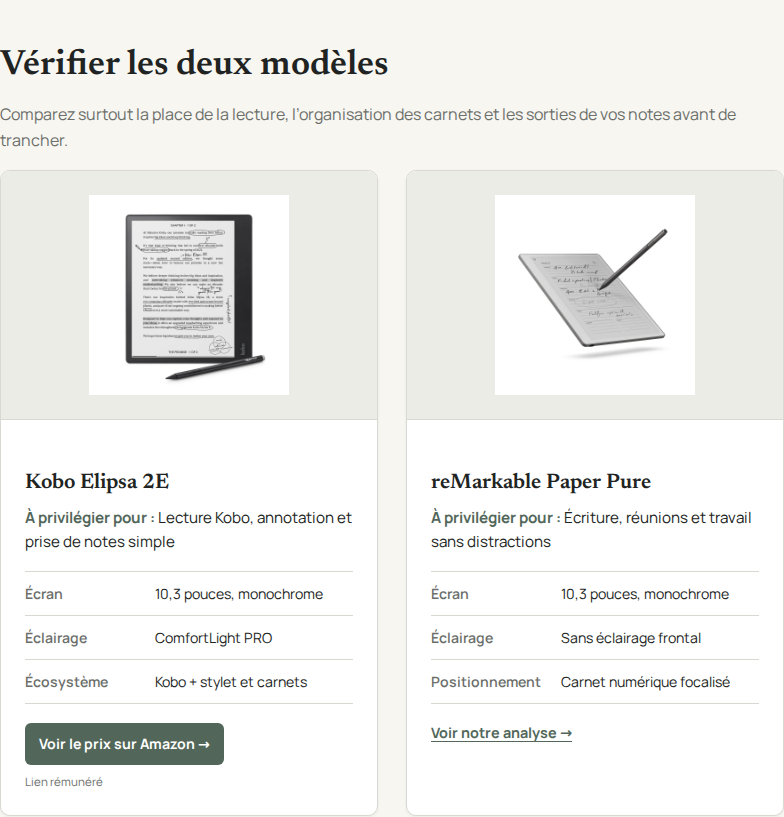
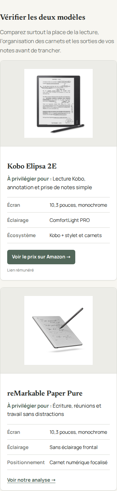
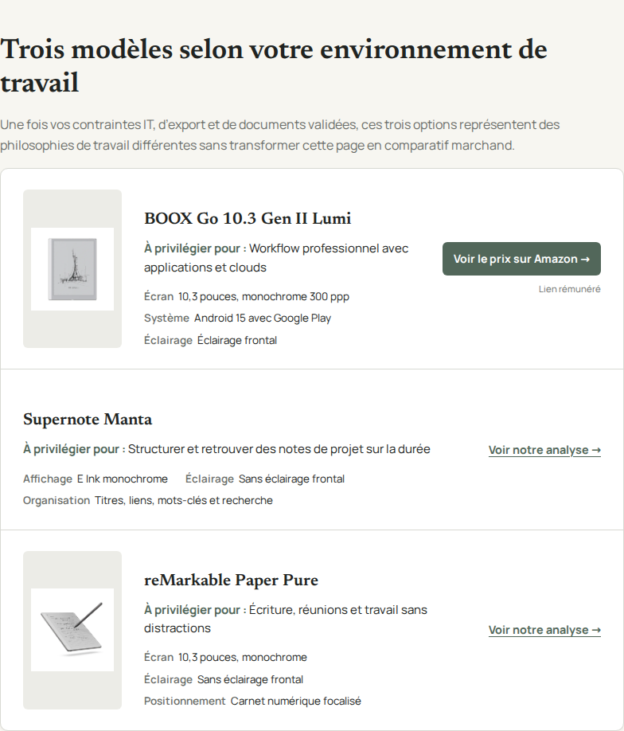
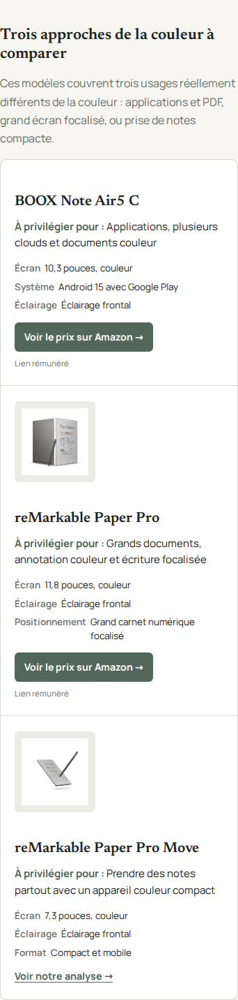

# Intégration des visuels produits — 29 octobre 2026

**Statut : partiel, 6 visuels officiels intégrés sur 12. Aucune fusion ni publication.**

Branche : `editorial/product-images-rights-audit-20261029`. PR : [#31](https://github.com/MarcW88/bloc-notes-numerique/pull/31).

Les visuels sont les packshots officiels des fabricants, notamment les galeries reMarkable intitulées « Product renders ». Ils représentent les modèles exacts ; aucune image n’a été générée par IA dans cette mission. Ce rapport ne les présente pas comme des photographies prises lors de tests physiques.

## Catalogue

| Produit | Image locale | Statut |
|---|---|---|
| reMarkable Paper Pure | `/assets/products/remarkable-paper-pure.webp` | Intégré |
| reMarkable Paper Pro | `/assets/products/remarkable-paper-pro.webp` | Intégré |
| reMarkable Paper Pro Move | `/assets/products/remarkable-paper-pro-move.webp` | Intégré |
| BOOX Note Air5 C | — | Autorisation de reproduction non établie |
| BOOX Go 10.3 (Gen II) | `/assets/products/boox-go-10-3-gen2.webp` | Intégré |
| BOOX Go 10.3 Gen II Lumi | `/assets/products/boox-go-10-3-lumi.webp` | Intégré |
| BOOX Note Max | — | Autorisation de reproduction non établie |
| BOOX Tab X C | — | Autorisation de reproduction non établie |
| Kindle Scribe (3e génération) | — | Autorisation de reproduction non établie |
| Kobo Elipsa 2E | `/assets/products/kobo-elipsa-2e.webp` | Intégré |
| Supernote Manta | — | Autorisation de reproduction non établie |
| Supernote Nomad | — | Autorisation de reproduction non établie |

## Fichiers et intégration

Six fichiers WebP distincts, 900 × 900 px, fond blanc, proportions conservées. Poids total : 134570 octets. Une image par modèle, réutilisée via le registre central : 29 références sur 19 pages. `loading="lazy"`, `decoding="async"`, dimensions HTML et `object-fit: contain` conservés. Les textes alternatifs sont propres aux vues des appareils.

La logique du dépôt stations-electriques-portables a été reprise : fichiers locaux dans `assets/products/`, traçabilité des sources et réutilisation des fichiers dans les modules HTML. Les sources d’accessoires du dépôt de référence restent distinctes des sources de ces appareils. Aucune nouvelle dépendance côté site.

Sources : [registre des fichiers](../../../.content/products/photo-sources-20261029.json) et [statut des 12 modèles](../../../.content/products/image-rights-audit-20261029.json). Les fabricants conservent leurs droits ; aucune licence Creative Commons n’est revendiquée.

## Pages HTML mises à jour

- `comparatifs/meilleur-bloc-notes-numerique/index.html`
- `comparatifs/tablette-e-ink/index.html`
- `comparatifs/bloc-notes-numerique-professionnel/index.html`
- `comparatifs/bloc-notes-numerique-etudiant/index.html`
- `comparatifs/bloc-notes-numerique-couleur/index.html`
- `comparatifs/bloc-notes-numerique-a4/index.html`
- `comparatifs/bloc-notes-numerique-sans-abonnement/index.html`
- `comparatifs/bloc-notes-numerique-pas-cher/index.html`
- `comparatifs/kindle-scribe-vs-remarkable/index.html`
- `comparatifs/kindle-scribe-vs-kobo-elipsa/index.html`
- `comparatifs/remarkable-vs-boox/index.html`
- `comparatifs/remarkable-vs-supernote/index.html`
- `comparatifs/boox-vs-supernote/index.html`
- `comparatifs/kobo-elipsa-vs-remarkable/index.html`
- `usages/prise-de-notes-professionnelle/index.html`
- `usages/prise-de-notes-etudiant/index.html`
- `usages/lecture-et-prise-de-notes/index.html`
- `guides/choisir-bloc-notes-numerique/index.html`
- `guides/annoter-pdf-tablette-e-ink/index.html`

## Modifications de code et CSS

- `product_cards.py` : texte alternatif issu du registre, avec repli sur le nom du modèle.
- `apply_product_cards.py` : remplacement au même emplacement des modules existants ; aucune accumulation d’espaces à la régénération.
- `validate_product_cards.py` : le comptage accepte les lignes portant la classe supplémentaire `--with-media`.
- `assets/product-cards.css` : élargissement de la colonne des libellés de caractéristiques pour éviter le chevauchement de « Positionnement ». Design général conservé.
- Contrôle Playwright existant : vérification du chargement, des dimensions, de `object-fit` et du texte alternatif ; captures ciblées des modules. Le header fixe est masqué uniquement pendant ces captures ciblées pour ne pas recouvrir les images. Les captures pleine page conservent le header.

## Tests

- `python validate_product_cards.py all` : PASS pour les 19 modules.
- `python validate_inline_affiliate_links.py` : PASS, 20 CTA inline vérifiés ; identifiant 500338-21 conservé.
- Comparaison de tous les href Amazon/sponsored avant et après : aucune suppression ni modification.
- `python -m unittest discover -s tests` : 4 tests PASS.
- `python validate_publication_indexation.py` : PASS, 89 routes approuvées conservées.
- `python validate_comparisons.py`, `python validate_guide_quality.py`, `python validate_usage_workflow.py` : PASS.
- `node --check` du script visuel et `git diff --check` : PASS.
- Décodage des 6 WebP avec Pillow, dimensions, empreintes distinctes, correspondance registre/HTML et régénération identique octet pour octet : PASS.
- Téléchargement des 6 fichiers depuis la branche GitHub : HTTP 200 et octets identiques aux fichiers locaux.
- Playwright sur GitHub Actions : 30 rendus comparatifs, 14 rendus usages, 50 rendus guides ; 58 images produits chargées, dimensions positives, `object-fit: contain` et alt présents. Aucune erreur de page/console, réponse non-200 ou largeur débordante dans ces trois scopes.
- Exécution locale de Chrome impossible (`socket() failed: Operation not permitted`) ; la revue a donc été exécutée dans GitHub Actions.

Revue visuelle : les vues des six modèles ont été inspectées dans les fichiers sources et les captures. Le cadrage conserve les appareils, les caractéristiques sont lisibles sur mobile et desktop. La présence d’images reste inégale tant que les six blocages ci-dessous ne sont pas levés.

## Modèles non intégrés

- **BOOX Note Air5 C** : Photos exactes trouvées sur la fiche officielle. Le kit presse téléchargé contient le Note Air6 C, pas le Air5 C : aucune substitution effectuée. Autorisation pour les fichiers Air5 C non établie. [Source consultée](https://shop.boox.com/products/noteair5c).
- **BOOX Note Max** : Photos exactes trouvées sur la fiche officielle. Le kit presse récupéré ne contient pas le Note Max ; aucune source autorisée du fichier exact établie. [Source consultée](https://shop.boox.com/products/notemax).
- **BOOX Tab X C** : Photos exactes trouvées sur la fiche officielle. Le kit presse récupéré ne contient pas le Tab X C ; aucune source autorisée du fichier exact établie. [Source consultée](https://shop.boox.com/products/tabxc).
- **Kindle Scribe (3e génération)** : Modèle 2025 distingué du Scribe 2024, du Colorsoft et de la version sans éclairage. Aucune autorisation de reproduction locale du fichier exact établie dans les ressources consultées. [Source consultée](https://www.aboutamazon.com/news/devices/new-amazon-kindle-scribe-color).
- **Supernote Manta** : Photos officielles trouvées. Les conditions du site demandent une autorisation écrite pour reproduire son contenu ; les ressources VI proposent logos et polices, pas les photos appareils. Aucune alternative autorisée établie. [Source consultée](https://supernote.com/products/supernote-manta).
- **Supernote Nomad** : Photos officielles trouvées. Même restriction de reproduction que pour Manta ; aucune alternative autorisée établie. [Source consultée](https://supernote.com/products/supernote-nomad).

Aucun message de demande de droits n’a été envoyé aux fabricants.

## Revue GitHub et captures

- [Intégration 9ce5a66](https://github.com/MarcW88/bloc-notes-numerique/commit/9ce5a667eabd04bacec832ea5b4305087ee5e47c)
- [Correction CSS et QA 074e00f](https://github.com/MarcW88/bloc-notes-numerique/commit/074e00fe6d652be8e43c6157774b9e84dc55d47f)
- [Alt et captures ciblées 20e9729](https://github.com/MarcW88/bloc-notes-numerique/commit/20e972938db1a68161d028af066dd8b88f51c6ed)
- [Workflow visuel contrôlé](https://github.com/MarcW88/bloc-notes-numerique/actions/runs/40852848085)

Les captures représentatives et rapports JSON sont conservés dans ce dossier. La PR demeure en brouillon. Aucune modification de main ni mise en production.

## Aperçus desktop et mobile

### Cartes comparatives — desktop

### Cartes comparatives — mobile

### Recommandations — desktop

### Recommandations couleur — mobile

