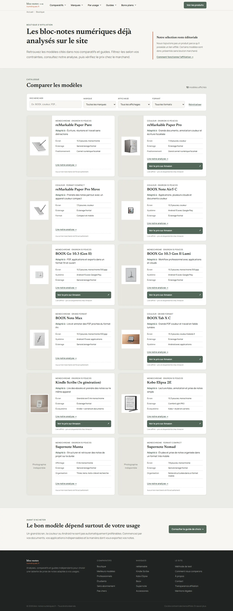
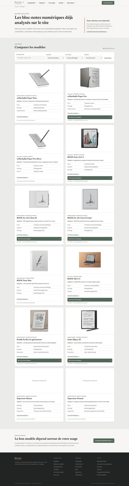
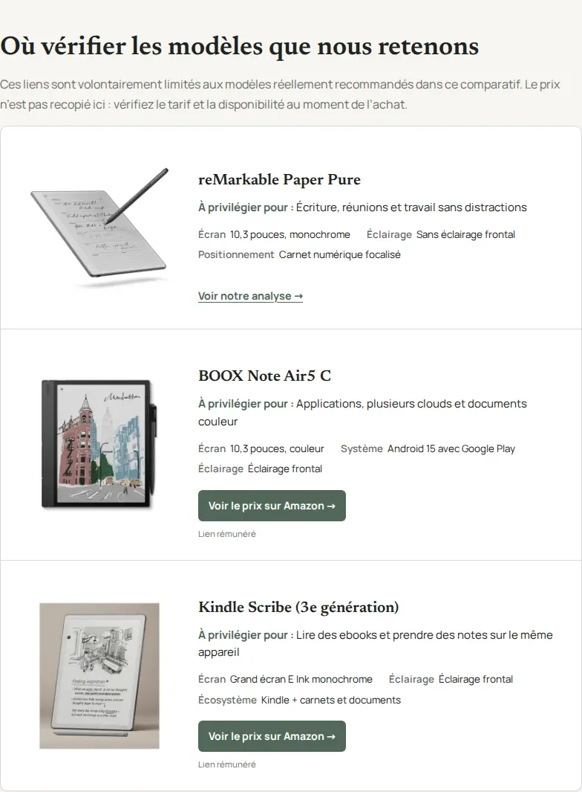

# Photographies produits — complément du 29 octobre 2026

10 photos locales sur les 12 attendues. Mission encore incomplète : Manta et Nomad nécessitent une source autorisant la republication. Aucun déploiement de ce complément.

| Produit | Image locale | Statut |
|---|---|---|
| reMarkable Paper Pure | /assets/products/remarkable-paper-pure.webp | Intégrée |
| reMarkable Paper Pro | /assets/products/remarkable-paper-pro.webp | Intégrée |
| reMarkable Paper Pro Move | /assets/products/remarkable-paper-pro-move.webp | Intégrée |
| BOOX Note Air5 C | /assets/products/boox-note-air5-c.webp | Intégrée |
| BOOX Go 10.3 (Gen II) | /assets/products/boox-go-10-3-gen2.webp | Intégrée |
| BOOX Go 10.3 Gen II Lumi | /assets/products/boox-go-10-3-lumi.webp | Intégrée |
| BOOX Note Max | /assets/products/boox-note-max.webp | Intégrée |
| BOOX Tab X C | /assets/products/boox-tab-x-c.webp | Intégrée |
| Kindle Scribe (3e génération) | /assets/products/kindle-scribe-3.webp | Intégrée |
| Kobo Elipsa 2E | /assets/products/kobo-elipsa-2e.webp | Intégrée |
| Supernote Manta | — | Bloquée : autorisation de reproduction non établie |
| Supernote Nomad | — | Bloquée : autorisation de reproduction non établie |

## Sources et contrôle des modèles

Voir `.content/products/photo-sources-20261029.json` pour les URL originales, crédits, empreintes SHA256 et tailles. Les quatre ajouts proviennent des photographies distribuées avec les communiqués BOOX / SKT et de la médiathèque presse Amazon. Le Note Max utilise le packshot monochrome du lancement SKT ; une photographie ambiguë du guide cadeaux a été écartée. Le Kindle correspond au Scribe monochrome redessiné de 2025, et non au Colorsoft ou au modèle Jade 2024. Aucun droit Creative Commons revendiqué.

## Blocage Supernote

Les pages produits exactes existent : https://supernote.com/pages/supernote-manta et https://supernote.com/pages/supernote-nomad . Les conditions de reproduction ne permettent pas de considérer ces photographies comme librement réutilisables. Les recherches dans les espaces presse, les prix de design et les sources sous licence libre n’ont pas fourni de licence exploitable pour une photographie authentique de chaque appareil. Les modèles 3D sous CC et les photos des générations précédentes ont été exclus. Il reste à obtenir une autorisation du titulaire ou une photographie originale licenciée. Contact officiel indiqué : market@supernote.com (aucun message envoyé).

## Pages HTML modifiées

- `boutique/index.html`
- `comparatifs/bloc-notes-numerique-a4/index.html`
- `comparatifs/bloc-notes-numerique-couleur/index.html`
- `comparatifs/kindle-scribe-vs-kobo-elipsa/index.html`
- `comparatifs/kindle-scribe-vs-remarkable/index.html`
- `comparatifs/meilleur-bloc-notes-numerique/index.html`
- `comparatifs/tablette-e-ink/index.html`
- `guides/annoter-pdf-tablette-e-ink/index.html`
- `guides/choisir-bloc-notes-numerique/index.html`
- `usages/lecture-et-prise-de-notes/index.html`

## Vérifications

- 10 WebP distincts valides, 900 × 900 ; 10 images dans la boutique.
- Regénération des 19 modules produits et de la boutique ; seuls les HTML concernés changent.
- validate_product_cards.py all : réussi.
- validate_inline_affiliate_links.py : réussi ; comparaison avant/après des href Amazon sur tous les HTML modifiés : identiques.
- validate_publication_indexation.py : réussi.
- unittest : 4 tests réussis ; git diff --check : réussi.
- GitHub Actions 40859520389 : les 6 contrôles visuels sont réussis (home/boutique, brands, comparisons, usages, guides, deals).
- Boutique : 10/10 images chargées sur chacun des formats 1440 × 1000 et 390 × 844, object-fit contain, aucune erreur console/page et aucun débordement horizontal.
- Comparatifs : 30 rendus, 60 références photo chargées.
- Inspection visuelle des sources et des captures boutique desktop/mobile effectuée.
- Aucun changement CSS dans ce complément.

## Captures

## Correction de la taille des photos (retour sur captures)

La version précédente réservait seulement 104–115 px aux images. La boutique place maintenant les photos au-dessus du contenu, avec une surface de 260 px de haut (max. 300 px de large). Les listes comparatives passent à une colonne photo de 210 px avec une image de 220 px de haut ; les actions se placent sous le texte. Sur mobile, la photo est centrée au-dessus des informations. Les duels utilisent 240 px de haut. `object-fit: contain` est conservé.

Les marges blanches excessives des huit packshots ont été réduites. Les fonds périphériques du Kindle Scribe et du Tab X C ont été recadrés pour rendre les appareils plus visibles, sans couper les appareils ou leurs accessoires. Les deux fichiers existants sont réutilisés : aucune variante supplémentaire de fichier. Les textes et liens affiliés n'ont pas changé.

Fichiers CSS : `style.css` et `assets/product-cards.css`. Ce complément reste dans la PR #33, sans fusion ni publication. Les captures originales plus haut documentent la première intégration ; les captures `*-large-photos.webp` documentent cette correction.

Contrôle final : [GitHub Actions 40873154545](https://github.com/MarcW88/bloc-notes-numerique/actions/runs/40873154545), commit `d8d5f1b`. Les six jobs visuels réussissent. Boutique : 10 images chargées sur chacun des deux viewports, surface image mesurée 300 × 260 px. Comparatifs : 30 rendus, 60 références chargées ; photos desktop mesurées 210 × 220 px. Aucune erreur console/page ou débordement horizontal sur ces routes. Captures inspectées sur desktop et mobile.

